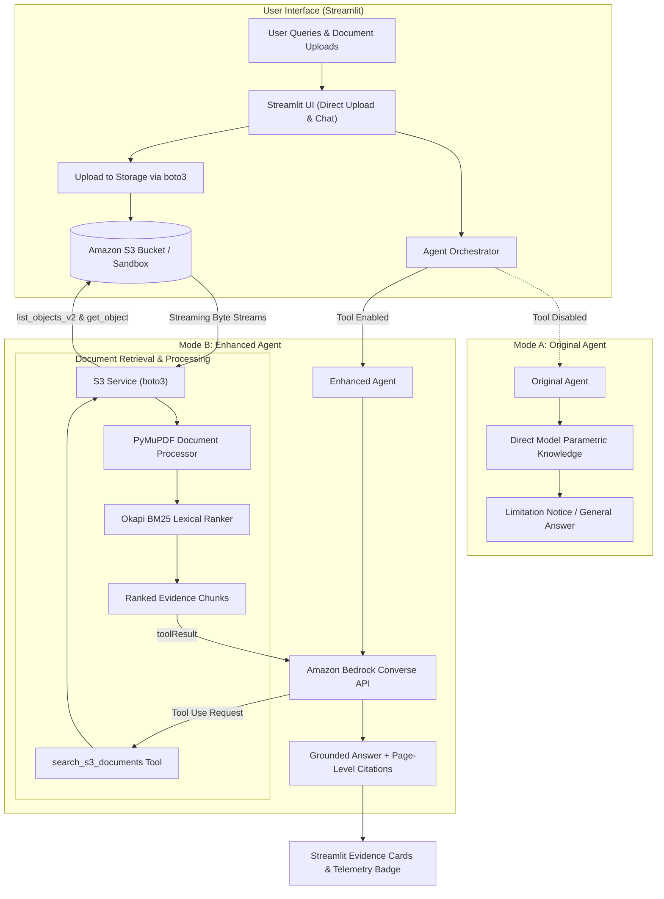

# DocuMind AI — Intelligent Document Retrieval Agent

> **An AI agent that retrieves stored documents from Amazon S3 and delivers verifiable, evidence-backed answers with page-level citations.**

[](https://documind-ai-intelligent-document-retrieval-agent-eqnahtisuqdmn.streamlit.app/)
[](https://www.python.org/)
[](https://aws.amazon.com/sdk-for-python/)
[](https://aws.amazon.com/bedrock/)
[]()
[](LICENSE)

---

## 🌐 Live Application

Experience the live interactive application directly in your browser:

🔗 **[Launch DocuMind AI on Streamlit Cloud](https://documind-ai-intelligent-document-retrieval-agent-eqnahtisuqdmn.streamlit.app/)**

---

## 1. Project Overview

**DocuMind AI** is an enterprise-grade AI agent that bridges the gap between large language models and private cloud document repositories. Rather than relying on generic model training weights that may hallucinate, DocuMind AI leverages a callable **Amazon S3 Document Retrieval Tool (`search_s3_documents`)** to retrieve raw enterprise documents, extract passages page-by-page, perform lexical ranking, and generate grounded answers backed by transparent citations.

### The Problem It Solves
- **Hallucinations & Guesswork:** Standard AI models cannot reliably answer questions regarding proprietary company policies, employee benefits, technical manuals, or institutional guidelines.
- **Lack of Traceability:** Users need to know *exactly* which document and *which page* a policy number or directive originated from.
- **Secure Access Control:** Documents remain isolated in enterprise S3 buckets and are retrieved strictly on-demand without copying raw data to third-party vector databases.

---

## 2. Core Capabilities

- 📤 **Live Document Uploads:** Upload `.pdf` and `.txt` files directly through the web interface with size validation, collision protection, and immediate indexing.
- ⚡ **Autonomous Tool Invocation:** The agent invokes the `search_s3_documents` tool using the Amazon Bedrock Converse API native tool-calling protocol.
- 📄 **Page-Aware PDF Extraction:** Powered by PyMuPDF (`fitz`), text chunks retain exact page numbers and document metadata for citation provenance.
- 🔍 **Transparent Lexical Ranking:** Okapi BM25 ranking algorithm ($k_1=1.5, b=0.75$) ranks retrieved chunks and produces concise query-density excerpts.
- ⚖️ **Side-by-Side Mode Evaluation:**
  - **Original Agent (Baseline):** Demonstrates un-tooled model behavior, explaining boundary constraints when queried on private repository files.
  - **Enhanced Agent (With S3 Tool):** Executes the full S3 retrieval cycle and synthesizes verified answers with supporting evidence cards and tool telemetry.
- 🛡️ **Zero-Credential Demo Sandbox:** Seamlessly runs out-of-the-box in local demo sandbox mode when AWS credentials are not configured, and automatically switches to live AWS S3 and Amazon Bedrock when credentials are provided.
- 🔒 **Security Best Practices:** Adheres to the AWS Well-Architected framework—no credential logging, safe streaming socket closures, and prompt injection isolation.

---

## 3. Architecture & Retrieval Pipeline



---

## 4. Technology Stack

| Component | Technology | Description |
| :--- | :--- | :--- |
| **Frontend** | Streamlit | Responsive executive interface with evidence cards and telemetry |
| **Cloud Storage** | Amazon S3 & boto3 | Secure object storage, pagination (`list_objects_v2`), and streaming retrieval |
| **LLM Runtime** | Amazon Bedrock | Converse API tool-use loop (`anthropic.claude-3-haiku-20240307-v1:0`) |
| **PDF Processing** | PyMuPDF (`pymupdf`) | High-fidelity page-by-page text extraction and metadata preservation |
| **Information Retrieval** | Okapi BM25 | In-memory lexical ranking algorithm with sliding-window chunking |
| **Testing & Mocking** | `pytest` + `moto` | 34 automated unit and integration tests with in-memory AWS emulation |

---

## 5. Amazon S3 Tool Specification

The explicit agent tool `search_s3_documents` conforms to the Amazon Bedrock Converse API tool schema:

```json
{
  "name": "search_s3_documents",
  "description": "Search permitted documents stored in the configured Amazon S3 bucket and return relevant evidence for answering a user question.",
  "parameters": {
    "type": "object",
    "properties": {
      "query": {
        "type": "string",
        "description": "The user's natural-language question or key search terms to locate evidence for."
      },
      "prefix": {
        "type": "string",
        "description": "Optional permitted S3 prefix for restricting the search (e.g. 'documents/')."
      },
      "max_results": {
        "type": "integer",
        "description": "Maximum number of relevant passages to return (default: 4)."
      }
    },
    "required": ["query"]
  }
}
```

---

## 6. Project Directory Structure

```text
DocuMind AI/
├── app.py                            # Streamlit entry point & user interface
├── requirements.txt                  # Production dependencies
├── .env.example                      # Template for configuration parameters
├── .gitignore                        # Git ignore rules (protects .env and credentials)
│
├── app/
│   ├── config.py                     # App configuration & credential masking
│   ├── agent/
│   │   ├── original_agent.py         # Mode A: Baseline agent without tools
│   │   ├── enhanced_agent.py         # Mode B: S3 retrieval-equipped agent
│   │   └── orchestrator.py           # Multi-mode coordinator & comparison engine
│   ├── tools/
│   │   └── s3_document_tool.py       # Explicit S3 search tool & Bedrock schema
│   ├── services/
│   │   ├── s3_service.py             # boto3 S3 client & sandbox storage engine
│   │   ├── document_processor.py     # PyMuPDF page-aware PDF/TXT extraction
│   │   ├── retrieval_service.py      # Okapi BM25 passage ranker & chunker
│   │   └── llm_service.py            # Amazon Bedrock adapter & local synthesis engine
│   └── ui/
│       └── components.py             # Executive CSS, evidence cards, status badges
│
├── sample_documents/                 # Fictional enterprise policies for demonstration
│   ├── fictional_leave_policy.pdf
│   ├── fictional_internship_handbook.pdf
│   └── fictional_reimbursement_policy.txt
│
└── tests/                            # Automated test suite (34 tests)
    ├── test_s3_service.py
    ├── test_document_processor.py
    ├── test_retrieval_service.py
    ├── test_s3_document_tool.py
    └── test_agent_orchestration.py
```

---

## 7. Quickstart & Local Setup

### Prerequisites
- Python 3.10 or higher
- Git

### 1. Clone the Repository
```bash
git clone https://github.com/chandana-builds/DocuMind-AI-Intelligent-Document-Retrieval-Agent.git
cd DocuMind-AI-Intelligent-Document-Retrieval-Agent
```

### 2. Create and Activate a Virtual Environment
```bash
# Windows
python -m venv venv
.\venv\Scripts\activate

# macOS / Linux
python3 -m venv venv
source venv/bin/activate
```

### 3. Install Dependencies
```bash
python -m pip install --upgrade pip
python -m pip install -r requirements.txt
```

### 4. Configuration (Optional)
The application works immediately in **Local Demo Sandbox Mode** without any configuration. To connect to your live AWS S3 bucket and Amazon Bedrock models:

1. Copy `.env.example` to `.env`:
   ```bash
   cp .env.example .env
   ```
2. Update `.env` with your AWS credentials:
   ```env
   AWS_REGION=us-east-1
   S3_BUCKET_NAME=your-s3-bucket-name
   AWS_ACCESS_KEY_ID=your-aws-access-key-id
   AWS_SECRET_ACCESS_KEY=your-aws-secret-access-key
   LLM_PROVIDER=bedrock
   BEDROCK_MODEL_ID=anthropic.claude-3-haiku-20240307-v1:0
   ```

### 5. Launch the Application
```bash
python -m streamlit run app.py
```
Open **`http://localhost:8501`** in your browser.

---

## 8. Verification & Test Suite

The project includes 34 unit and integration tests covering the S3 client, document processing, BM25 ranking, and agent tool execution:

```bash
python -m pytest tests/ -v
```

### Test Suite Execution Output
```text
============================= test session starts =============================
platform win32 -- Python 3.10.11, pytest-9.1.1
collected 34 items

tests/test_agent_orchestration.py::test_original_agent_lacks_s3_tool PASSED      [  2%]
tests/test_agent_orchestration.py::test_enhanced_agent_invokes_s3_tool_and_grounds_answer PASSED [  5%]
tests/test_agent_orchestration.py::test_compare_modes_execution PASSED          [  8%]
tests/test_agent_orchestration.py::test_no_relevant_evidence_handled_without_fabrication PASSED [ 11%]
tests/test_agent_orchestration.py::test_llm_failure_handled_without_fabrication PASSED [ 14%]
tests/test_document_processor.py::test_process_pdf_pages_and_metadata PASSED    [ 17%]
tests/test_document_processor.py::test_process_txt_extraction PASSED            [ 20%]
tests/test_document_processor.py::test_process_corrupt_pdf PASSED               [ 23%]
tests/test_document_processor.py::test_unsupported_format PASSED                [ 26%]
tests/test_document_processor.py::test_empty_bytes PASSED                       [ 29%]
tests/test_document_processor.py::test_process_scanned_pdf_without_text PASSED [ 32%]
tests/test_retrieval_service.py::test_bm25_retrieval_leave_days PASSED          [ 35%]
tests/test_retrieval_service.py::test_bm25_retrieval_internship_stipend PASSED [ 38%]
tests/test_retrieval_service.py::test_bm25_retrieval_no_match PASSED            [ 41%]
tests/test_retrieval_service.py::test_bm25_empty_query_or_passages PASSED       [ 44%]
tests/test_s3_document_tool.py::test_tool_schema_definition PASSED              [ 47%]
tests/test_s3_document_tool.py::test_tool_execution_success PASSED              [ 50%]
tests/test_s3_document_tool.py::test_tool_execution_empty_query PASSED          [ 52%]
tests/test_s3_document_tool.py::test_tool_execution_empty_bucket PASSED         [ 55%]
tests/test_s3_service.py::test_check_s3_connection_success PASSED               [ 58%]
tests/test_s3_service.py::test_check_s3_connection_missing_bucket PASSED        [ 61%]
tests/test_s3_service.py::test_list_documents PASSED                            [ 64%]
tests/test_s3_service.py::test_retrieve_document_success PASSED                 [ 67%]
tests/test_s3_service.py::test_retrieve_document_not_found PASSED               [ 70%]
tests/test_s3_service.py::test_retrieve_document_too_large PASSED               [ 73%]
tests/test_s3_service.py::test_upload_document_success PASSED                   [ 76%]
tests/test_s3_service.py::test_upload_valid_pdf_to_s3 PASSED                    [ 79%]
tests/test_s3_service.py::test_upload_rejects_empty_file PASSED                 [ 82%]
tests/test_s3_service.py::test_upload_rejects_unsupported_file_type PASSED     [ 85%]
tests/test_s3_service.py::test_upload_rejects_oversized_file PASSED             [ 88%]
tests/test_s3_service.py::test_document_list_refreshed_after_upload PASSED     [ 91%]
tests/test_s3_service.py::test_safe_key_generation_and_collision_avoidance PASSED [ 94%]
tests/test_s3_service.py::test_invalid_key_traversal PASSED                     [ 97%]
tests/test_s3_service.py::test_check_s3_connection_detailed_categories PASSED  [100%]

======================= 34 passed in 10.20s ========================
```

---

## 9. Security & Production Readiness

- **Least Privilege Access:** The S3 integration requires only read (`s3:GetObject`, `s3:ListBucket`) and write (`s3:PutObject`) permissions restricted to a defined key prefix (`documents/`).
- **Prompt Injection Defense:** Retrieved document excerpts are bounded inside `<retrieved_evidence>` XML delimiters with explicit instructions forbidding the LLM from treating document content as system instructions.
- **Resource Protection:** Enforces strict upload file size caps (default: 10 MB per file) and verifies supported MIME types (`.pdf`, `.txt`).
- **Zero Credential Exposure:** `.env` is ignored by default in `.gitignore`, and the user interface masks all bucket names and credentials.

---

## 10. License

This project is licensed under the [MIT License](LICENSE).
